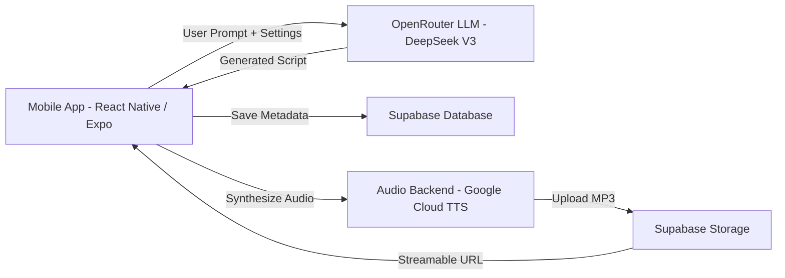

# 🎙️ Resona — Interfaith SDG Podcast Generator

[](https://reactnative.dev)
[](https://expo.dev)
[](https://supabase.com)
[](https://cloud.google.com/text-to-speech)
[](LICENSE)

**Resona** is an innovative AI-powered mobile application designed to bridge faith, ethics, and global sustainability. It enables users to generate personalized, high-quality audio podcasts that explore the intersection of **World Religions** and the **United Nations 17 Sustainable Development Goals (SDGs)**.

---

## 🌟 Key Features

- **🕊️ Interfaith Wisdom**: Explore perspectives from Christianity, Islam, Hinduism, Buddhism, Sikhism, Judaism, and universal ethical traditions.
- **🌍 17 UN SDGs**: Deep dives into climate action, poverty eradication, quality education, clean water, peace, and more.
- **🎭 6 Script Styles**: Tailor each podcast to your preferred tone:
  - *Storytelling*, *Educational*, *Conversational*, *Humorous*, *Spiritual*, or *Motivational*.
- **🗣️ Multilingual Neural Audio**: Powered by **Google Cloud Text-to-Speech (Neural2)** supporting 8 languages:
  - English (`en-US`), Hindi (`hi-IN`), Spanish (`es-ES`), French (`fr-FR`), German (`de-DE`), Arabic (`ar-XA`), Japanese (`ja-JP`), and Chinese (`cmn-CN`).
- **☁️ Cloud Library & Social Feed**: Saved podcasts, streamable audio URLs, social sharing, and real-time community engagement powered by **Supabase**.
- **🏆 Gamification**: Unlockable achievements, category badges, streaks, and progress tracking.

---

## 🏗️ Architecture



---

## 🛠️ Tech Stack

| Component | Technology |
|---|---|
| **Mobile Frontend** | React Native 0.79, Expo SDK 53, React 19 |
| **Navigation** | React Navigation (Stack + Custom Collapsible Bottom Tabs) |
| **Backend & Database** | Supabase (PostgreSQL, Auth, Storage, Realtime) |
| **AI Script Generation** | OpenRouter API / DeepSeek |
| **Text-to-Speech** | Google Cloud Text-to-Speech (Neural2 & WaveNet engines) |
| **Audio Playback** | Expo AV |

---

## 🚀 Getting Started

### Prerequisites

- [Node.js](https://nodejs.org) (v18 or higher recommended)
- [Expo Go](https://expo.dev/go) on your physical mobile device, or Android Studio for emulator
- A [Supabase](https://supabase.com) account (free tier works great)
- An [OpenRouter](https://openrouter.ai) account for AI script generation
- *(Optional)* A Google Cloud service account with Text-to-Speech API enabled for self-hosted audio synthesis

---

### Installation

1. **Clone the repository:**
   ```bash
   git clone https://github.com/SagarX2005/PodcastOn-UN-SGD-goals.git
   cd PodcastOn-UN-SGD-goals
   ```

2. **Install dependencies:**
   ```bash
   npm install
   ```

3. **Configure Environment Variables:**
   Copy the example environment file:
   ```bash
   cp .env.example .env
   ```
   Open `.env` and fill in your Supabase project credentials:
   ```env
   EXPO_PUBLIC_SUPABASE_URL=https://your-project.supabase.co
   EXPO_PUBLIC_SUPABASE_ANON_KEY=your-supabase-anon-key
   PORT=3001
   ```

4. **Database Setup:**
   Run the complete SQL setup script located at [`supabase/schema.sql`](supabase/schema.sql) in your Supabase SQL Editor. This will automatically set up all 11 tables, Row Level Security (RLS) policies, triggers, and storage buckets (`podcasts` and `profile-pictures`).

---

### Running the App

#### Start the Metro Bundler:
```bash
npx expo start
```

- **Android Emulator**: Press `a` in the terminal.
- **Physical Device**: Scan the terminal QR code using **Expo Go** (Android) or the Camera app (iOS).
- **Web Browser**: Press `w` in the terminal.

#### Start the Audio Generation Backend:
```bash
node backend/server.js
```

---

## 🔒 Security & Privacy

- All sensitive keys (`.env`, `service-account.json`, private tokens) are excluded via `.gitignore`.
- User API keys are stored exclusively on the user's phone in the device secure keystore (via expo-secure-store) and are never sent to or stored in the database.

---

## 📄 License

This project is licensed under the [MIT License](LICENSE).
